# High-Innovation Bearing Fault Diagnosis Model Based on GADF+Swin-CNN-GAM!

A bearing fault diagnosis model based on Gram matrix GADF+Swin Transformer window attention and CNN-GAM global attention! This is our innovative model, yet to be published! For those in need, buy and use it immediately!!!

Dataset: CWRU Xi'an University Bearing Dataset (Tested, the model achieves 100% classification accuracy on both the CWRU Xi'an University Bearing Dataset and Harbin Institute of Technology Aerospace Engine Bearing Dataset!)
Environmental framework: Python 3.9, PyTorch 1.8 or above are required for running
Accuracy: 100% on test set
Usage: Paper requirements, graduation design requirements
Code guarantee: Code with detailed comments, ready to run without modification.
Code includes:
(1) Training visualization
(2) Original data t-SNE feature visualization
(3) T-SNE feature visualization after model training
(4) Confusion matrix
(5) Classification label visualization
Innovation points:
(1) Convert one-dimensional time-series fault signals into two-dimensional images through the Gram matrix GADF;
(2) Branch one: Image data extracts local features of fault images through the window attention mechanism of Swin Transformer;
(3) Branch two: Fault images simultaneously extract global spatial features through the GAM-Attention based CNN2d convolutional pooling network;
(4) Then, the extracted global spatial features and local features from both branches are fused through adaptive average pooling, enabling the model to better integrate different level feature representations, improving model performance and generalization capability.
Note: In this product, we also provide accompanying models explanation (for learning network structure) and parameter adjustment explanation, providing detailed explanations!
We also provide classification and processing methods for time-frequency images related to one-dimensional time-series signals, including the Gram matrix GAF, Continuous Wavelet Transform (CWT), Short-Time Fourier Transform (STFT), etc. We offer an interface for changing the dataset, allowing for a one-click replacement of signal data and transformation processing for different images, facilitating experimental validation of this innovative model!
One-dimensional fault signal data
Gram matrix GAF transformed two-dimensional image data
Electric power quality disturbance signal GAF transformed two-dimensional image data
Continuous Wavelet Transform (CWT) time-frequency plot data
Short-Time Fourier Transform (STFT) time-frequency plot data
Classification network model based on GADF+Swin-CNN-GAM
Set parameters, train the model
50 epochs, accuracy near 100%. The classification effect of the GADF+Swin-CNN-GAM network is significant. The innovative model can fully extract global spatial and local features of bearing fault signals, with fast convergence speed, superior performance, high accuracy, and noticeable results!
Model evaluation
Accuracy, Precision, Recall, F1 Score
Fault classification confusion matrix:
Previously excellent content:
Python-Kansas State University (CWRU) Bearing Data Interpretation and Classification Processing
Python Bearing Fault Diagnosis (I) Short-Time Fourier Transform STFT
Python Bearing Fault Diagnosis (II) Continuous Wavelet Transform CWT
Python Bearing Fault Diagnosis (III) Empirical Mode Decomposition EMD
Pytorch-LSTM Bearing Fault One-Dimensional Signal Classification (I)
Pytorch-CNN Bearing Fault One-Dimensional Signal Classification (II)
Pytorch-Transformer Bearing Fault One-Dimensional Signal Classification (III)
Python Bearing Fault Diagnosis (IV) Based on EMD-CNN Classification
Python Bearing Fault Diagnosis (V) Based on EMD-LSTM Classification
Python Bearing Fault Diagnosis (VI) EMD-Transformer-Based Fault Classification
Python Bearing Fault Diagnosis (VII) EMD-CNN-LSTM-Based Fault Classification
Python Bearing Fault Diagnosis (VIII) EMD-CNN-GRU Parallel Model-Based Fault Classification
Bearing Fault Identification Model Based on FFT + CNN - BiGRU-Attention for Time and Frequency Feature Attention Fusion
Bearing Fault Identification Model Based on FFT + CNN - Transformer for Time and Frequency Feature Fusion
Python Bearing Fault Diagnosis (IX) EMD+CNN-BiLSTM-Based Fault Classification
Python Bearing Fault Diagnosis (X) EMD+CNN-Transformer-Based Fault Classification
Python Bearing Fault Diagnosis (XI) EMD+CNN-BiGRU-Attention-Based Fault Classification
Cross Attention Fusion of Time and Frequency Features with EMD+CNN-BiLSTM Bearing Fault Identification Model
Cross Attention Fusion of Time and Frequency Features with EMD+CNN-Transformer-CrossAttention Bearing Fault Identification Model
Python Bearing Fault Diagnosis Tutorial
Python Bearing Fault Diagnosis (XIII) Super-Learning Machine Recognition Model Based on Fault Signal Feature Extraction
Python Bearing Fault Diagnosis (XIV) High-Innovative Fault Recognition Model
Python Bearing Fault Diagnosis (XV) One-Dimensional Fault Signal Recognition Model Based on CNN-Transformer

## Images

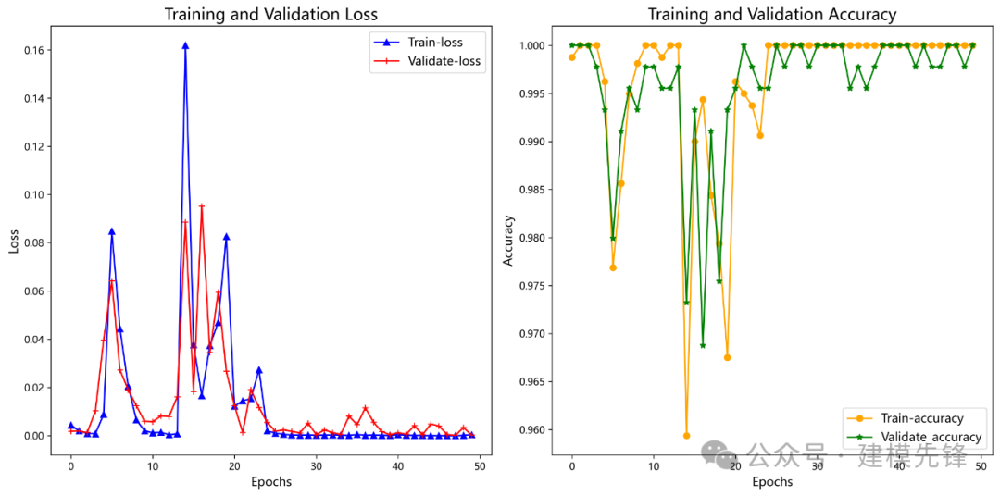
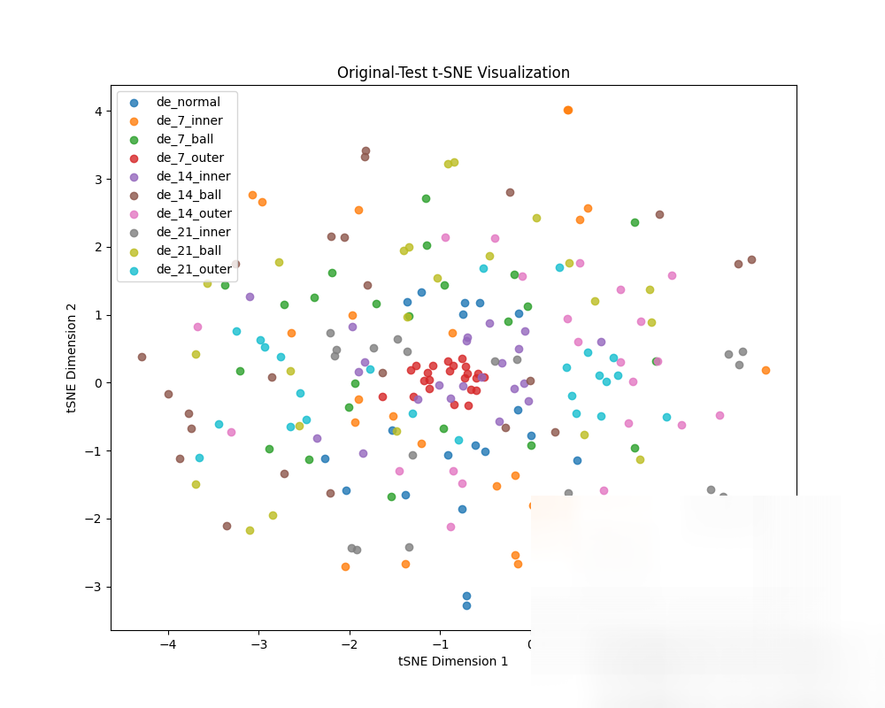
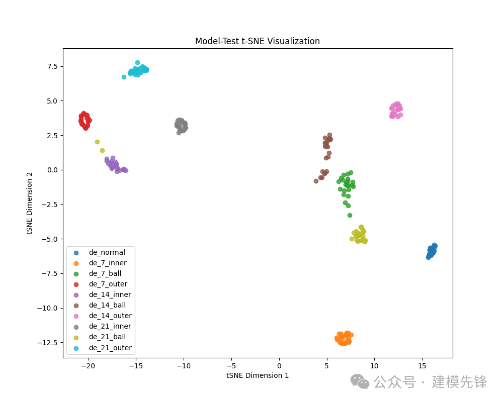

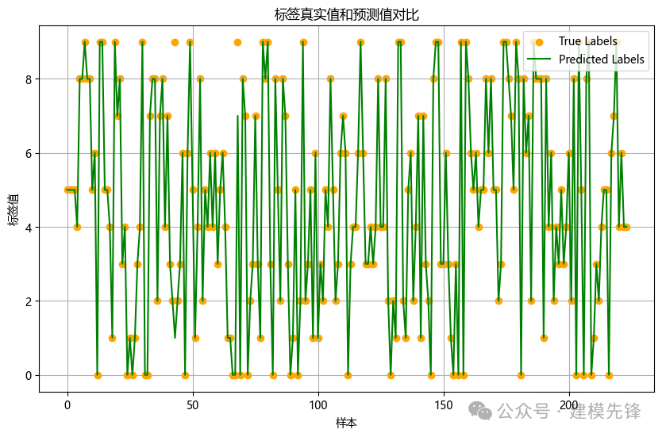
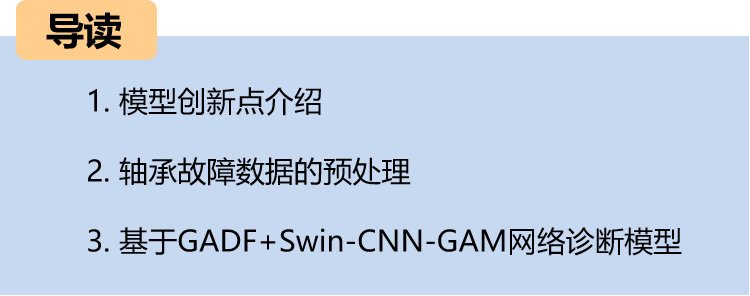
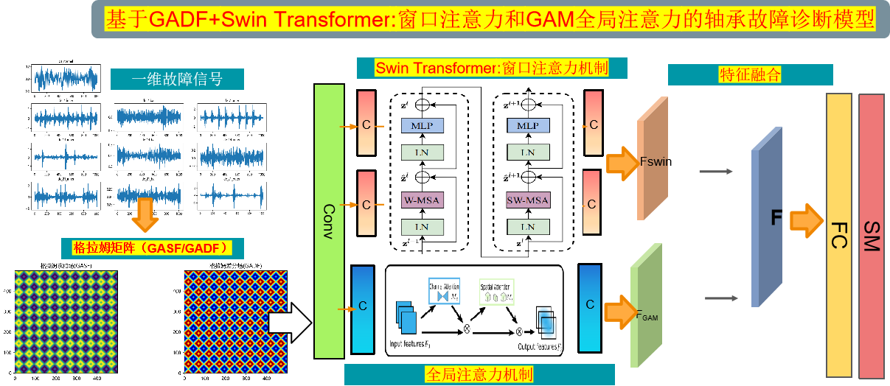
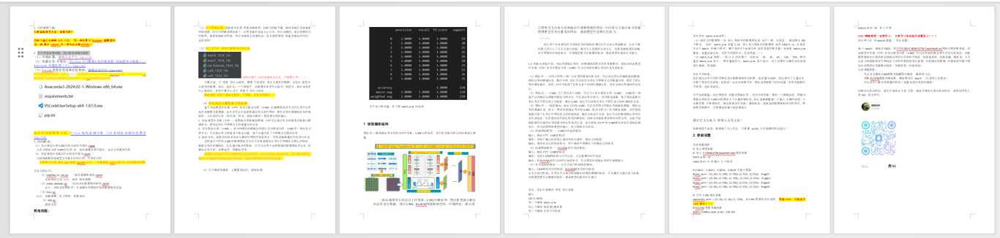
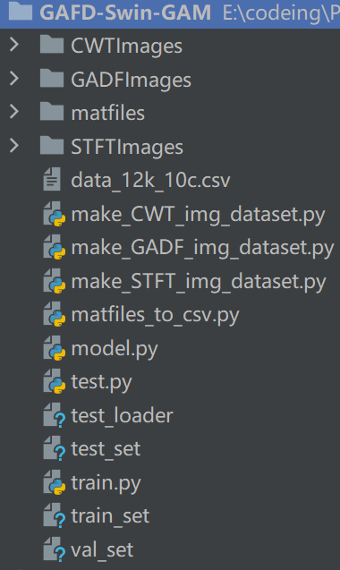

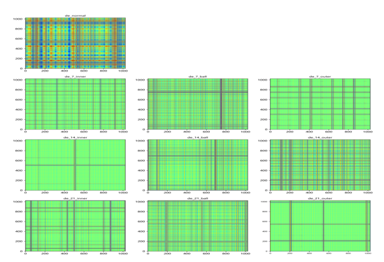

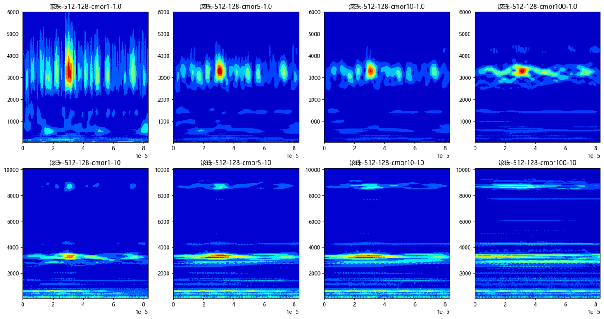
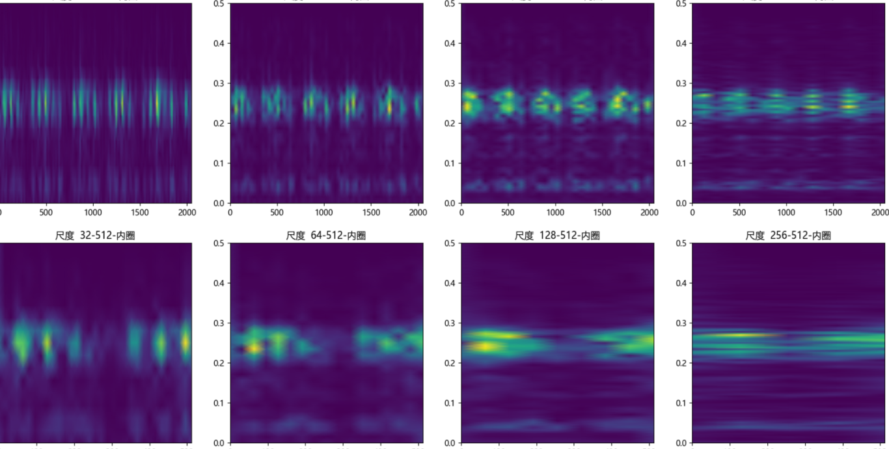

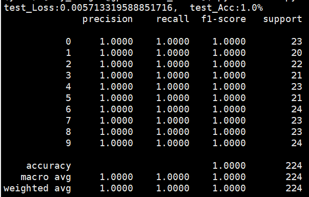
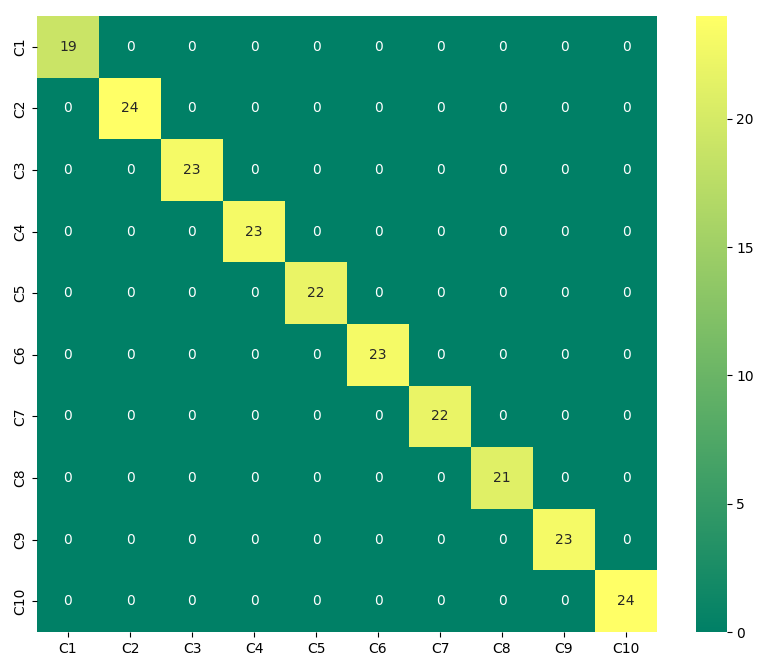
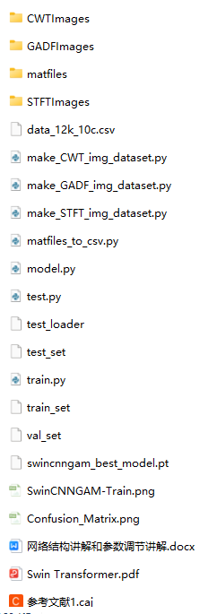

<!-- PAYMENT_BLOCK -->

## Get this dataset

- Payment link (Stripe): [Buy now](https://buy.stripe.com/3cs8yP7sY87d0vu9AB)
- Payment QR code: 

<!-- /PAYMENT_BLOCK -->
